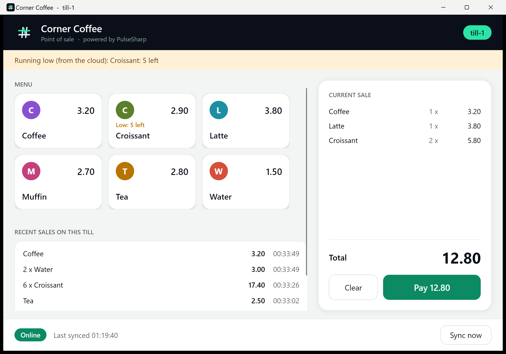

# PulseSharp samples: a coffee shop from the till to the cloud

A small but complete system built on [PulseSharp](https://github.com/pulsesharp/pulsesharp), the lightweight events and jobs library for .NET.

- **Till.Desktop** is a desktop till (Avalonia, runs on Windows, macOS and Linux). It keeps its own SQLite file, so it **keeps selling with no internet** and sends its sales to the cloud when it can.
- **Shop.Api** is the cloud (ASP.NET Core and PostgreSQL). It receives the sales, keeps stock, prints receipts, adds up the day in a job, and sends the menu and low-stock warnings back to the tills.
- **Shop.Tests** shows how to test all of it with `PulseSharp.Testing`.



## The story

1. You open the shop. The API puts six products on the menu.
2. You open two tills. They receive the menu and show it as buttons.
3. You sell. Each sale is saved in the till's own database first, then synced.
4. The internet goes down (stop the API). The status bar says **Offline** and counts the sales that are waiting. Selling still works. When the API is back, the sales arrive, each one exactly once.
5. The cloud takes sold items out of stock. When a product runs low, every till shows a warning.
6. The receipt printer breaks. PulseSharp retries, then holds back that till's receipts. You fix the printer and press **Retry failed**.
7. A manager changes a price. Every till shows the new price.
8. At the end of the day a job adds up the sales.

## Run it in 5 minutes

You need the [.NET 10 SDK](https://dotnet.microsoft.com/download) and Docker.

> **Until PulseSharp 0.6.0-alpha is on nuget.org**, build the packages from a local PulseSharp checkout first (see [Using an unreleased PulseSharp](#using-an-unreleased-pulsesharp)). After the release this step is not needed.

```bash
docker compose up -d --wait
dotnet run --project src/Shop.Api
```

Open <http://localhost:5100>. This is the shop console: stock, latest sales, problems and the receipt printer.

In two more terminals, start two tills:

```bash
dotnet run --project src/Till.Desktop -- --till till-1
dotnet run --project src/Till.Desktop -- --till till-2
```

Now try the story:

| Do this | See this |
|---|---|
| Tap products, press **Pay** | The sale appears in the till's list, then in the console a moment later. Stock goes down. |
| Stop `Shop.Api` (Ctrl+C), sell two more things | The till says **Offline** and **2 sale(s) are waiting**. Selling still works. |
| Start `Shop.Api` again | Within seconds the till says **Online** and the sales show up in the console, once each. |
| Sell 7 croissants | The console shows the low stock, and a warning appears on both tills. |
| Press **Break the printer** in the console, then sell | After 3 tries the receipt handler stops for that till. The console lists the problem. |
| Press **Fix the printer**, then **Retry failed** | The held-back receipts print, in order. |
| `curl -X PUT localhost:5100/menu/tea/price -H "Content-Type: application/json" -d "{\"price\":2.80}"` | Tea costs 2.80 on both tills. |
| `curl -X POST localhost:5100/reports/run`, then `curl localhost:5100/reports` | The day's report. `curl localhost:5100/admin/jobs` shows the job. |

Start over: delete the till folder (`%LocalAppData%/PulseSharpSamples` on Windows, `~/.local/share/PulseSharpSamples` on Linux) and run `docker compose down -v`.

## Where to look

| You want to see | Look at |
|---|---|
| One-line setup on PostgreSQL | [`Shop.Api/Program.cs`](src/Shop.Api/Program.cs) |
| One-line setup on SQLite, with sync | [`Till.Desktop/TillHost.cs`](src/Till.Desktop/TillHost.cs) |
| The simple level: `When<T>(...)` and `Emit(event)` | [`Till.Desktop/TillHost.cs`](src/Till.Desktop/TillHost.cs) |
| A handler class with services, listening to two event types | [`Menu/ProductProjection.cs`](src/Shop.Api/Menu/ProductProjection.cs) |
| Handlers that are safe to repeat (events arrive at least once) | [`Sales/SalesLedger.cs`](src/Shop.Api/Sales/SalesLedger.cs), [`Stock/StockKeeper.cs`](src/Shop.Api/Stock/StockKeeper.cs) |
| An event saved in the same database transaction as your own data | [`Stock/StockKeeper.cs`](src/Shop.Api/Stock/StockKeeper.cs) (`EmitOptions.Transaction`) |
| A failing handler, retries, retry and skip | [`Receipts/`](src/Shop.Api/Receipts), [`Admin/AdminEndpoints.cs`](src/Shop.Api/Admin/AdminEndpoints.cs) (`IPulseControl`) |
| A job with progress, planned for later | [`Reports/DailyReportHandler.cs`](src/Shop.Api/Reports/DailyReportHandler.cs) (`EnqueueAt`) |
| Putting the first data in place once, all or nothing, even with several instances | [`ShopStartup.cs`](src/Shop.Api/ShopStartup.cs) (`EmitAll`, `ExpectedVersion.NoStream`) |
| The sync server, what a till may receive and what it may write | [`Shop.Api/Program.cs`](src/Shop.Api/Program.cs) (`UseSyncServer`, `PushStreams`, `MapPulseSharpSync`) |
| Keeping admin endpoints away from the network | [`Admin/AdminOnly.cs`](src/Shop.Api/Admin/AdminOnly.cs) |
| Sync status, how many sales are waiting, and "Sync now" in a UI | [`MainViewModel.cs`](src/Till.Desktop/ViewModels/MainViewModel.cs) (`IPulseSync`, `Status.Waiting`, `StatusChanged`) |
| Tests: fakes, handlers, the real engine, a real database | [`tests/Shop.Tests`](tests/Shop.Tests) |
| Stream names both sides agree on | [`Shop.Contracts/Streams.cs`](src/Shop.Contracts/Streams.cs) |

## Tests

```bash
dotnet test
```

- `ReceiptSenderTests`, `ReportSchedulingTests`: plain unit tests with `FakePulse` and `handler.Handle(...)`.
- `TillScreenTests`: the till's real handlers on the real engine (`PulseTestHost`), checking what the screen would show.
- `ShopApiTests`: the whole API in the test process on a throwaway PostgreSQL database, including a till that tries to change the menu and cannot. They skip themselves when the container from `docker compose` is not running.
- `AdminOnlyTests`: the admin endpoints answer only to this machine, or with the key.

## How light is it?

PulseSharp is meant to be small: few dependencies, low memory and CPU, and your own database. `tools/Shop.Measure` measures that on this very system, next to a plain ASP.NET Core app with no PulseSharp and no database, so you can see what PulseSharp itself costs.

| What | Result |
|---|---|
| Machine | 12 logical cores, 31.8 GB RAM, Microsoft Windows 10.0.22631, .NET 10.0.10 |
| Database | PostgreSQL 17 in Docker on the same machine |
| Start-up, plain ASP.NET Core (median of 5, to first `/health`) | 592 ms |
| Start-up, Shop.Api with PulseSharp (median of 5) | 1,128 ms |
| First start on an empty database (creates the tables) | 1,113 ms |
| Memory at idle, plain ASP.NET Core | 46 MB |
| Memory at idle, Shop.Api with PulseSharp (30 s after start) | 67 MB |
| Load | 5 tills x 2000 sales = 10,000 sales (each sale: 2 lines, 3 handlers in the cloud) |
| **one stream per till and day (what Shop.Api's tills do)** | |
| &nbsp;&nbsp;Tills selling (SQLite, one commit per sale) | 10.0 s, 1,001 sales/s in total |
| &nbsp;&nbsp;Sync + cloud handling, start to last sale handled | 20.6 s, 486 sales/s, 1,457 handler runs/s |
| &nbsp;&nbsp;Cloud memory, peak / 10 s after | 132 MB / 126 MB |
| &nbsp;&nbsp;Cloud CPU during load (share of one core) | 6% |
| &nbsp;&nbsp;Cursor rows after the load | 16 |
| **one stream per sale** | |
| &nbsp;&nbsp;Tills selling (SQLite, one commit per sale) | 9.3 s, 1,078 sales/s in total |
| &nbsp;&nbsp;Sync + cloud handling, start to last sale handled | 19.3 s, 519 sales/s, 1,557 handler runs/s |
| &nbsp;&nbsp;Cloud memory, peak / 10 s after | 142 MB / 133 MB |
| &nbsp;&nbsp;Cloud CPU during load (share of one core) | 7% |
| &nbsp;&nbsp;Cursor rows after the load | 30,001 |
| PulseSharp in the publish folder | 4 DLLs, 326 KB |

What this shows:

- **The cost of PulseSharp itself** is small: about 21 MB more memory at idle than plain ASP.NET Core (67 MB against 46 MB), about 30 ms more to start once the tables exist, and 4 DLLs of 326 KB in total. It adds no service to run: the events and jobs live in the PostgreSQL (cloud) and SQLite (till) databases the app already uses.
- **Under load** the cloud handled 10,000 sales (30,000 handler runs, each with its own database work) in about 21 seconds, 486 sales per second, using 6% of one core. The five tills needed 10 seconds to make the sales (one SQLite commit per sale), and the cloud had handled the last one about 10 seconds after that.
- **Stream choice matters for size.** One stream per sale leaves 30,001 cursor rows after 10,000 sales, and the cloud used about 10 MB more at its peak. One stream per till and day leaves 16 rows. Per-sale streams were a little faster here, because more streams are handled side by side.
- **Memory after the load** stays above idle (about 126 MB against 67 MB) 10 seconds later. We have not yet checked how much of that is .NET keeping memory for reuse and how much is PulseSharp.
- **Start-up varies a little.** The first start on an empty database, which creates the tables, took about 1.1 seconds. Starts after that took about 0.62 seconds (plain ASP.NET Core: 0.59) in repeated runs, but one long run showed 1.1 seconds, so run it a few times.

Run it yourself (it needs the Docker container and takes a few minutes):

```bash
dotnet run -c Release --project tools/Shop.Measure
```

These numbers come from one developer machine with PostgreSQL in Docker on the same machine. Yours will differ. Treat them as a way to compare, not as a promise.

## Things worth knowing

- **Handlers are repeated sometimes.** Delivery is at least once, so every handler here is safe to run twice: inserts use `ON CONFLICT DO NOTHING`, and the stock keeper remembers which sales it already counted.
- **Pick streams on purpose.** Events in one stream are handled in order, and PulseSharp keeps one cursor per handler and stream. A stream per sale would keep a cursor row per handler for every sale forever, so the tills use one stream per till and day (`Sale-till-1-2026-10-23`). The price: if a handler keeps failing on a sale, that till's later sales wait behind it until you retry or skip it. The numbers above show the difference.
- **Recovery after a crash.** If an app instance is killed, the restarted app or another instance takes over its handlers after 10 seconds and its running jobs after 30. A normal stop hands them over at once. A handler that hangs is stopped after `Advanced.HandlerTimeout` (5 minutes) and retried, so one stuck handler can never block its stream for good.
- **Security.** A till can write only streams that start with `Sale-` and its own name; the server refuses anything else, so a till can never change the menu (`PushStreams`). The console and the admin endpoints answer only to requests from this machine; for other machines set `Admin:Key` and send it as the `X-Admin-Key` header. The till keys in `appsettings.json` are demo values: use real secrets, and HTTPS between the tills and the cloud, in your own app.
- **Old events.** Events are kept forever. The coarse streams above keep the cursor table small; the events table grows by one row per event.

## Using an unreleased PulseSharp

The projects use the NuGet packages, not project references. To try a PulseSharp you have cloned next to this repo:

```powershell
./scripts/pack-local.ps1
```

It packs PulseSharp into `.local-feed` with a unique version (NuGet caches by version) and points the samples at it. Delete `.local-feed` to go back to the published version.

## License

MIT
